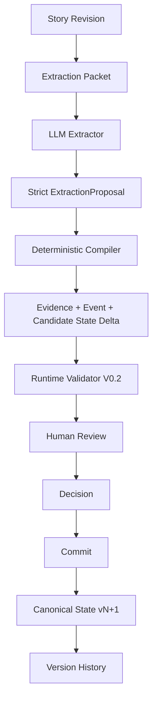

# StoryState Final MVP Architecture

## Problem

Long-horizon stories accumulate facts, beliefs, transfers, reversals, and superseded claims. A prompt, summary, or retrieval result can contain relevant history without establishing which statement is the current truth. StoryState maintains an explicit, versioned Canonical State with exact source provenance and a human-controlled mutation boundary.

## System boundaries

- **Next.js frontend:** Library, Setup, Workspace, Review, State, and History. It renders backend projections and sends explicit user actions through an isolated adapter.
- **Next.js API routes:** transport boundary for state reads, source creation, extraction, decisions, commits, versions, and restore. Route handlers contain no product mutation logic.
- **StateService:** application authority for validation, decisions, optimistic version checks, Canonical mutation, snapshots, and restore.
- **ExtractionService:** one bounded extractor request, strict parsing, deterministic compilation, atomic candidate persistence, and per-candidate Runtime Validator calls.
- **StateRepository:** transaction port. The production implementation uses PostgreSQL and locks one Story as the serialization boundary; tests use an in-memory implementation or PGlite.
- **External model providers:** server-only dependencies behind provider-neutral adapters. They receive a bounded model-safe projection and cannot access the database or commit state.

Frontend display contracts remain separate from backend domain schemas. The deterministic `fog-harbor` slug-to-UUID mapping exists only in the frontend identity adapter; backend IDs remain validated UUIDs.

## Core data model

- **Story:** current State Version, current Chapter, and Story Revision. Chapter and State Version advance independently.
- **Source Document / Source Revision:** immutable story input with monotonic source ordering and canonical or author-only visibility.
- **Evidence:** an exact UTF-16 span anchored to one Source Revision.
- **Event:** an append-only narrative occurrence linked to Evidence and participants. An Event is not itself State.
- **Candidate State Delta:** a typed proposed mutation with before/after values, evidence, provenance, risk, validator result, decisions, and commit linkage.
- **Canonical State:** typed current records for characters, items, plot threads, propositions, world truth, character knowledge, and relationships.
- **State Version:** an immutable snapshot produced by Commit or Restore. Restore produces a new version and never deletes history.
- **Derived Annotation:** non-canonical interpretation that cannot silently become Canonical State.

## End-to-end sequence

Workspace first creates a Source Document and Source Revision. Extraction builds a bounded packet with opaque aliases, performs exactly one Extractor call, parses the frozen proposal, and compiles exact persisted artifacts. Candidate validation runs independently after atomic persistence, so one unexpected validator failure becomes a sanitized `VALIDATOR_UNAVAILABLE` issue without orphaning the run. Review is rehydrated from repository data. The user accepts or rejects candidates, and Commit applies only accepted, admissible IDs at the expected State Version.

## Responsibility separation

| Component | Owns | Does not own |
| --- | --- | --- |
| Extractor | Semantic interpretation | IDs, persistence, Decision, Commit |
| Deterministic Compiler | Alias resolution, exact spans, typed proposal compilation | Model inference or user authority |
| Runtime Validator V0.2 | Deterministic admission checks, bounded semantic support, risk routing | Human Decision or Canonical mutation |
| Human Review | Accept/Reject authority | Direct database writes |
| StateService | Transactional Canonical mutation and versions | Free-form model reasoning |
| Repository | Isolation and persistence | Product policy |

## Safety invariants

- The model-visible packet contains opaque aliases; Canonical UUID mappings remain server-side.
- The LLM never directly mutates Canonical State.
- Extract never creates a Human Decision, commits, or advances a State Version.
- Recommendations and validator outputs do not substitute for explicit user Decisions.
- Evidence must match exact source spans and belong to the referenced Event/Story.
- World Truth and Character Knowledge remain separate typed concepts.
- Item holder, owner, and custodian compile and validate independently.
- All accepted deltas are checked again at Commit, including expected version and before-value freshness.
- A stale `409` mutation is not automatically retried.
- Rejected candidates remain audit records but are excluded from active Review hydration.
- Validator/provider failures fail safe into review and do not create automatic acceptance.
- Restore creates a governed new version and preserves the complete version chain.

## Implemented versus roadmap

The implemented MVP includes the full Source Revision → Extraction → deterministic Compiler → Runtime Validator → Human Review → Commit → State/History loop, PostgreSQL persistence, migrations, deterministic seed data, restore, and real frontend/backend adapters.

The following remain roadmap items: vector RAG/pgvector, the broader Writer-facing Context Compiler, MCP Connector, broad Writer integrations, authentication/multi-tenancy, and hosted operations. RAG can later improve retrieval, but it does not replace StoryState’s current-truth and governance responsibilities.

## Important tradeoffs

- **Conservative review over automatic throughput:** uncertain, unsupported, unavailable, and high-impact changes remain reviewable instead of becoming automatic mutations.
- **Structured truth over flexible prose:** strict typed contracts reject malformed or semantically invalid proposals, which reduces ambiguity at the cost of requiring explicit compiler rules.
- **One Generic validator call over Specialist fan-out:** the frozen architecture experiment found equal bounded semantic accuracy with lower call count and latency for Generic validation. This result is dataset-scoped and is not a general accuracy claim.
- **Story-level transaction boundary:** locking one Story makes version and mutation behavior clear and auditable. Very high write concurrency would require future operational work.
- **Same Next.js deployment for UI and API:** this keeps the MVP deployable without a separate backend service while preserving server-only secrets and a repository abstraction.

## Deployment contract

The application expects PostgreSQL with the committed migration and seven server-only variables: `STORYSTATE_DATABASE_URL`, the three `STORYSTATE_EXTRACTOR_*` variables, and the three `STORYSTATE_VALIDATOR_*` variables. Provider keys must never use `NEXT_PUBLIC_*`. Historical `DEEPSEEK_API_KEY` evaluation configuration is deliberately separate from production.

The codebase is compatible with a single Vercel Next.js deployment, but the final release environment had no database, provider, or Vercel credentials. Deployment and real runtime smoke therefore remain blocked operationally; the product implementation and deterministic test coverage are complete.
