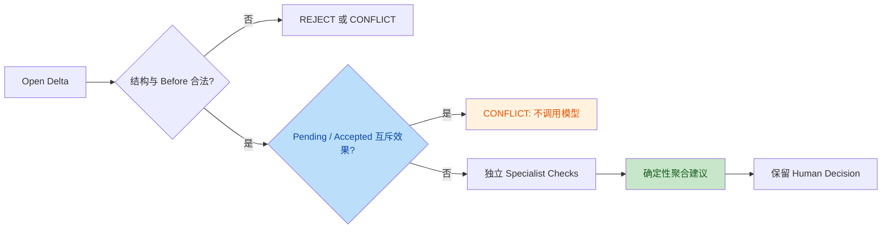
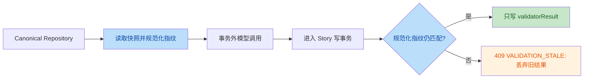

# Stage 2.2 Runtime Validator

Status: completed / merged main / frozen. Runtime Validator V0.1 engineering / governance validation complete; LIVE SEMANTIC MODEL ACCURACY NOT YET VALIDATED.
Implementation base main: `2dca51fde053bc066b9ca787772e24c987e3795f`. Stage 1.3, 2.1 and 2.1.2 remain completed/frozen.
Provenance: Astra implementation `b5b88299f638415d14f4bde24813035342ea50df`; Astra self-review `2a28ead17190d158134c7e3c015b74992579d086`; Codex independent review `66703ed659e4c46b2b376c28ec0cdbfb69f8bda2`. All three commits remain in the non-squash merge history.

## Goal and architecture

Validate an existing open Candidate State Delta and persist a recommendation, never a human decision or canonical mutation:

```text
StateService.validateDelta
  -> RuntimeValidator
  -> deterministicGate (existing governance dry-run)
  -> ValidationContextProvider (bounded structured evidence)
  -> ValidationOrchestrator (deterministic routing)
       Evidence / Knowledge Boundary / Temporal State
  -> aggregateChecks (ordinary deterministic TypeScript)
  -> transactional validatorResult write
```

Why hybrid: schema, references and stale state are executable contracts; evidence entailment, character access and temporal interpretation need semantic judgment. Why specialists: each has a narrowly defined prompt and output responsibility. This is not evidence that three prompts outperform a generic model; no real-model comparative evaluation was run. There is one shared model client, no fourth judge, no framework, no agent conversation, no reflection and no retry.

## Deterministic gate

Reuses `deltaInputSchema`, `validateDelta`, `applyDelta` and `validateCanonical`. `applyDelta` is run against a private aggregate clone with an internal simulated accepted value; it does not record a decision, persist the clone, or call commit. Existing correction provenance, psychological-state, thread-resolution and reference rules therefore remain enforced.

Invalid schema/operation/lifecycle/reference/knowledge representation -> failed/REJECT.
Stale expected version, stale before or incompatible effects from a pending (`needs_review`) / accepted mutation -> conflict/CONFLICT. Rejected and deferred proposals are not active competitors. Whole-record and field proposals are compared by changed fields, not by payload shape; agreeing effects are not conflicts. Existing commit stale-before checks still prevent duplicate application.
A terminal gate prevents context/model calls. Missing/inactive UPDATE targets are contract failures. CREATE checks canonical absence. NO_CHANGE remains audit only and cannot create a version.

The existing Stage 2.1.2 `assertValidatorAcceptable` still owns decision-time and commit-time admission; it is not duplicated or weakened.

## Validation packet and retrieval

Canonical current state comes only from the story-scoped repository aggregate (PostgreSQL in production, Memory in tests). Evidence never reconstructs current truth.

Packet fields:

- Candidate delta input and ID, excluding legacy proposal confidence, risk, author and decision/result fields.
- Current typed canonical target and relevant Character, Proposition, Reported Proposition, WorldTruth and CharacterKnowledge rows.
- Primary Evidence from candidate evidenceIds.
- Retrieved Evidence with source revision, order, chapter, exact span and Event IDs.
- Provenance: story ID, state version, story revision, current chapter, source Event ID/order/time/participants and truncation flag.

Deterministic retrieval prioritizes primary evidence, source Event links, relevant participant-linked Event evidence within the previous four source-order positions, then evidence from committed same-target deltas. Reported propositions expand one hop through explicit canonical IDs. There is no text similarity search, embedding or pgvector.

All evidence must be in the same story aggregate, have an exact source span, and come from the latest canonical revision for its document. Future evidence beyond the candidate source order is excluded. Author-only revisions, rejected delta assertions, soft annotations and speculation are never supplied as authority. Evidence associated with invalidated assertions is conservatively excluded; this can over-filter shared evidence and cause review. An evidence quote used by a rejected candidate may still be legitimate raw text via an independent Event link; the rejected candidate itself is never supplied.

Hard bounds: 12 primary + 12 retrieved evidence records, 1600 characters per quote, 32 current-state rows, 32000 UTF-8 bytes for the packet. Primary evidence is never silently truncated. Unavailable/superseded primary evidence or oversized required context produces context UNCERTAIN/NEEDS_REVIEW without model calls. Retrieval truncation is explicit and prevents AUTO_ACCEPT even if all model checks support.

Prompt instructions separate canonical current truth from historical retrieval and treat candidate/evidence text as untrusted data, not instructions. Prompt protection reduces but does not eliminate model prompt-injection risk.

**Stage 2.2 structured retrieval != full RAG.**

## Specialists and routing

Each output is a strict object: agent, verdict, reason, evidenceIds.
Verdict is SUPPORTED / UNCERTAIN / UNSUPPORTED. Reason is at most 600 characters and 1-3 short sentences, not chain-of-thought. Citations must be unique packet Evidence IDs. Story-derived SUPPORTED requires at least one citation. Unknown fields, wrong agent, invented citations, invalid enums, markdown wrappers or missing grounding fail parsing.

| Specialist | Responsibility |
| --- | --- |
| Evidence | Exact Before -> After entailment, not relevance; holder != owner, Event != State, sufficient resolution, relationship scope |
| Knowledge Boundary | Who received which proposition at which stance; P != Q, reported R != underlying F, no reader/world propagation, false belief/correction |
| Temporal State | Historical/current/future, destination/lead, last confirmed/unresolved, knowledge acquired now about past facts |

| Target | Route |
| --- | --- |
| knowledge | Evidence + Knowledge Boundary + Temporal |
| characters.location or whole character record | Evidence + Temporal |
| other character fields | Evidence |
| items (including owner), worldTruth, plotThreads | Evidence + Temporal |
| relationships, propositions | Evidence |

Whole records are conservatively routed for contained temporal changes. Owner also receives Temporal because ownership can be historical or conditional. No LLM chooses the route.

## Model boundary

`SemanticModelClient` is shared by all three prompts. Tests inject a deterministic fake. The optional `ChatCompletionsSemanticClient` implements an OpenAI-compatible structured chat-completion boundary with env-only configuration:

- `STORYSTATE_VALIDATOR_ENDPOINT`: full HTTPS chat-completions URL.
- `STORYSTATE_VALIDATOR_MODEL`: one model identifier.
- `STORYSTATE_VALIDATOR_API_KEY`: secret supplied only at runtime.

One response per specialist, temperature 0, n=1, max_tokens=500, strict JSON schema, no tools, redirects rejected. Response body is capped at 24000 bytes. Each specialist has a 15-second timeout and an abort signal. The three independent requests run sequentially and never see one another's responses. No retries.

Missing/invalid configuration uses an unavailable client, not a fake runtime fallback. No online provider call was made and provider-specific schema compatibility has not been live-certified. The adapter was tested using a mocked transport, including truncation and output schema handling.

**Confidence status: NOT IMPLEMENTED.** Existing frozen Delta/Annotation confidence fields remain unchanged for compatibility; no new semantic confidence is returned, scored, persisted or sent to the model.

## Conservative admission

| Condition | Final status / recommendation |
| --- | --- |
| Deterministic contract failure | failed / REJECT |
| Deterministic unresolved state/version conflict | conflict / CONFLICT, risk CONFLICT |
| Any semantic UNSUPPORTED or UNCERTAIN | needs_review / NEEDS_REVIEW |
| Missing/duplicate/failed routed checks, context unavailable/truncated | needs_review / NEEDS_REVIEW |
| All SUPPORTED, high impact or review-required policy | needs_review / NEEDS_REVIEW |
| All SUPPORTED, complete context, low impact | passed / AUTO_ACCEPT_ELIGIBLE |

LLM UNSUPPORTED != REJECT: semantic judgments are fallible recommendations. Stage 2.2 explicitly reserves hard REJECT for code-proven contract violations. A human can review a semantic disagreement under NEEDS_REVIEW; the validator does not reject the human decision on their behalf. Existing hard commit checks still apply.

Static impact policy: every knowledge mutation needs review (suspects/believes MEDIUM; knows/correction HIGH); WorldTruth changes, relationship mutations, owner/whole-item mutations and thread resolution are HIGH. Non-story corrections/imports/overrides are also HIGH/review. Other clear event-based changes use simple LOW or MEDIUM categories; no numerical scoring. All relationships conservatively require review, not only long-term psychological ones.

## Persistence, API and concurrency

`POST /api/stories/:storyId/deltas/:deltaId/validate`

```json
{"expectedVersion": 1}
```

Equivalent service: `StateService.validateDelta(storyId, deltaId, input)`.
Existing open deltas only; unknown/foreign IDs return not found, committed deltas cannot be validated. No frontend consumes this API.

The existing `state_deltas.validator_result` JSONB stores optional backward-compatible checks and audit fields: validatorVersion, modelId, evaluatedAt, evaluatedAgainstVersion, evaluatedAgainstStoryRevision, packetHash. Old Stage 2.1 result objects and null remain valid. No SQL migration or repository persistence rewrite was necessary.

Only validatorResult is written. No decision, decision audit, State Version, Event or Canonical State is changed. Current result is traceable to its delta and cited Evidence IDs. This is latest-result persistence, not a new immutable history of every validation attempt.

Models run outside the transaction. Before writeback, a fingerprint checks the aggregate's state/version, sources/evidence/events, candidate inputs, decisions and validation results under the repository transaction. Unordered repository rows, join IDs and object keys are normalized; payload arrays and decision history retain their meaningful order. Any concurrent relevant update discards the result with VALIDATION_STALE (409); a concurrent commit is immutable and rejected. A newer result or human decision cannot be overwritten. The fingerprint is intentionally conservative and may reject a run after an unrelated actual change in the same story.

## Ten-case benchmark

Independent files: `tests/runtime-validator-benchmark.test.ts`, `tests/runtime-validator.test.ts`, `tests/fixtures/runtime-validator.ts`.
The frozen contract representation tests and fixture were not modified. New candidates have hand-authored minimal canonical baselines and literal evidence from Frozen Benchmark Chapter Text.

S = SUPPORTED, U = UNSUPPORTED, "-" = not routed.

| Case | Candidate | Evidence | Knowledge | Temporal | Final |
| --- | --- | --- | --- | --- | --- |
| Ch13-A | USB holder Chen -> Lin | S | - | S | AUTO_ACCEPT_ELIGIBLE |
| Ch13-B | USB owner Chen -> Lin via handoff | U | - | S | NEEDS_REVIEW |
| Ch13-C | Lin unaware(P) -> knows(P), only Q clue | U | U | S | NEEDS_REVIEW |
| Ch13-D | Lin unaware(Q) -> suspects(Q) | S | S | S | NEEDS_REVIEW |
| Ch14-A | Chen unresolved, last confirmed Hospital | S | - | S | AUTO_ACCEPT_ELIGIBLE |
| Ch15-A | Lin unaware(F) -> believes(true) | S | S | S | NEEDS_REVIEW |
| Ch15-B | Gu knows F but only knows Lin reported F | U | U | S | NEEDS_REVIEW |
| Ch16-A | Gu knows exact P, disclosure + credential | S | S | S | NEEDS_REVIEW |
| Ch17-A | Father current North Embankment from lead | U | - | U | NEEDS_REVIEW |
| Ch17-B | Lin believes(true) -> knows(false) with provenance | S | S | S | NEEDS_REVIEW |

## Metrics and limits

These are **actual deterministic-fake engineering results**, not measured LLM intelligence or semantic accuracy. The fake emits the labeled verdicts by design; the test measures routing, result handling, aggregation, citation validity and non-mutation.

| Metric | Observed |
| --- | --- |
| Overall routing accuracy | 10/10 (100%) |
| False AUTO_ACCEPT count / all candidates | 0/10 (0%) |
| False AUTO_ACCEPT / unsafe candidates | 0/4 (0%) |
| Evidence verdict fixture agreement | 10/10 |
| Knowledge-boundary verdict fixture agreement | 6/6 |
| Temporal verdict fixture agreement | 10/10 |
| Evidence ID grounding validity | 68/68 (100% packet membership) |
| Real-model Evidence / Knowledge / Temporal accuracy | NOT MEASURED |
| Generic vs specialists comparison | NOT RUN; GenericSemanticValidator interface only |

Evidence membership is not proof of entailment. A live model evaluation is required before making quality claims or permitting any future automated acceptance policy.

## Failure semantics and verification

Provider exceptions, timeouts, refusal, truncated output, invalid JSON/schema or invented citations produce an UNCERTAIN check and NEEDS_REVIEW. Partial failure cannot be ignored. Raw provider errors and raw malformed model output are not persisted. Context failures do not call semantic specialists. None of these paths commits state or fabricates SUPPORTED.

Executed: npm install (up to date, 0 reported vulnerabilities; existing install-script approval warnings unchanged), build PASS, lint PASS.

| Suite | Result |
| --- | --- |
| npm test | 170/170 PASS after Codex independent review fix |
| npm run test:backend | 62/62 PASS |
| npm run test:benchmark | 11/11 PASS, frozen exact representation suite |
| npm run test:validator | 72/72 PASS after Codex independent review fix |
| Stage 1.3 automatic regression | 25/25 PASS |
| Stage 2.1/2.1.2 | Existing 62 backend + 11 exact tests unchanged and passing |
| PGlite migration | Actually executed from empty databases, including new validator JSONB round-trip/API test |

Node totals include parent tests and subtests. Hosted Supabase and live LLM validation were not run.

`npm run dev -- --port 3100` was attempted; that process exited and the existing same-repo server remained at `http://127.0.0.1:3013`. Read-only browser smoke checks passed for Library, Workspace, Review, State, History and Setup. Review had 7 details elements and 0 open by default. The available browser viewport was 454px wide; desktop-width visual acceptance was not completed. The pre-existing server was not stopped, and user decisions/state were not changed in the browser.

## Scope and review

**Stage 2.2 Runtime Validator != AI Extraction.** No AI Extraction, full RAG/pgvector, Context Compiler, frontend/backend migration, Writer Connector, MCP, Auth, hosted Supabase, new ontology, repository performance refactor, confidence scoring, reflection/debate or automatic commit.

Remaining risks: unmeasured live-model accuracy/provider compatibility, model prompt injection, bounded structured retrieval recall, conservative same-story invalidation of in-flight runs, latest-result-only audit, full-aggregate repository scaling, and existing unauthenticated write APIs. Do not expose this API publicly before the separate access-control stage.

The original implementation was local to Trae, followed by Astra self-review and Codex independent review. Product Owner final review passed; the reviewed branch was non-squash merged into main and the full verification suite reran successfully. Live Semantic Validation, AI Extraction, pgvector RAG, Context Compiler, Frontend–Backend Integration, Writer Connector, MCP and Deployment remain planned; no next stage has started.

## Astra Self-Review Corrections

Astra 在原提交 `b5b88299f638415d14f4bde24813035342ea50df` 后自行审核并修复三个 P2 问题，最终形成提交 `2a28ead17190d158134c7e3c015b74992579d086`。这不是 Codex 独立审核；Codex 随后重新复核了三个修复。仅修复 correctness，不重构 provider、repository 或 ontology。

| ID | 原缺陷与规则 | 最小修复 / 回归 |
| --- | --- | --- |
| R1 | pending 同 target/path 的互斥提案被忽略，违反 Frozen Rulebook 4.1/4.4，可误给 AUTO_ACCEPT | gate 同时检查 needs_review/accepted；Memory 与 PGlite 验证零模型调用的 CONFLICT |
| R2 | 同一 holder 变化用整行与字段表达时误报 CONFLICT | 比较实际 changed fields；覆盖等价、独立字段、互斥、INVALIDATE、Rejected/Deferred 与重复 commit 的 stale 保护 |
| R3 | raw JSON 指纹依赖未排序 SELECT 的行序，数据不变也会 VALIDATION_STALE | 仅规范化无序行、join IDs、对象键；真实 PGlite 查询计划切换、行序/键序/join 顺序与有序 payload 变化分别验证 |

新增 `tests/runtime-validator-review.test.ts` 的 17 个 Node test/subtest。原 temporal 单测将未使用的基础候选明确 deferred，避免两个候选同时存在而提前触发正确的 conflict gate；没有改变 temporal verdict、最终建议或 Frozen Ground Truth。

审核后的业务流程：



审核后的写回流程：



其余审核结论：生产代码无 benchmark case ID 特判；fake 只提供 specialist verdict，不提供最终 recommendation。三个 prompt 的职责独立，共享同一有界 packet，并不交换判断。已有 overflow、缺失上下文、partial failure、provider unavailable、输出解析及 citation 校验保持通过。实际语义准确率仍未测量，十案例的 fake 指标仍为 routing 10/10、false AUTO_ACCEPT 0/10（错误候选 0/4）。No confidence、无自动 Decision/Commit、latest-result-only audit 和三份 Frozen Docs 边界均保留。

## Codex Independent Review Correction

Codex 独立重跑验证并复核上述三个 P2 修复。额外发现指纹只投影给模型的候选字段，遗漏已有 DeltaInput 的 `confidence`、`risk`、`proposedBy`。模型等待期间若这些字段改变，原逻辑仍会写回旧 validatorResult，违反 Delta input 变化必须 `VALIDATION_STALE` 的并发约束。新增回归先在三个字段分别复现旧结果覆盖，随后仅将遗漏字段纳入写回指纹；模型 packet、语义评分与现有无序行/关联 ID 规范化均保持不变。合并后 main 重跑结果：build/lint PASS、全量 170/170、backend 62/62、exact benchmark 11/11、validator 72/72；PGlite 迁移和 JSONB 回读实际执行。工程与治理验证完成，真实模型语义准确率未验证。
